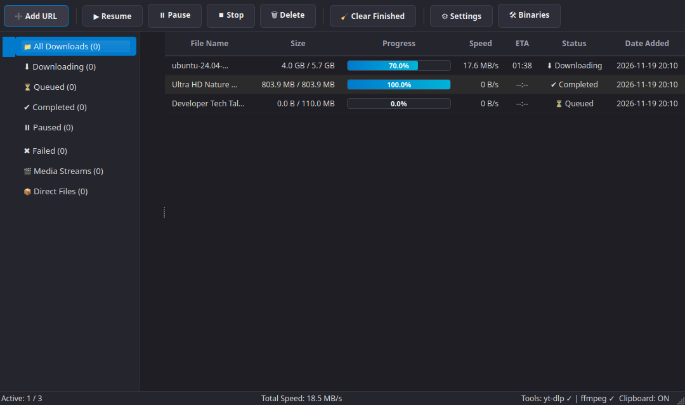

# Apex Download Manager (IDM-Inspired Desktop App)

A high-performance, modular desktop media and file download manager inspired by **Internet Download Manager (IDM)**, engineered with **Python 3.12+** and **PySide6 (Qt for Python)**.

<p align="center">
  
</p>

---

## 🚀 Key Features

### 1. High-Performance Segmented Download Engine
- **Multi-Connection Segmented Slicing**: Splits files into up to 32 concurrent HTTP range connections (`Accept-Ranges: bytes`), saturating available bandwidth.
- **Dynamic Speed Limiting**: Token-Bucket rate limiter allowing on-the-fly global bandwidth throttling.
- **Pause & Resume**: Graceful socket interruption with byte-level chunk tracking on disk. Resuming reconnects only missing byte ranges.
- **Fault-Tolerant Exponential Backoff**: Automatically handles transient network dropouts with configurable retry delays.

### 2. Media Extraction & YouTube / Facebook Support
- **Media Stream Extraction**: Deep integration with `yt-dlp` supporting YouTube, Facebook, TikTok, Vimeo, Twitter/X, Reddit, SoundCloud, and 1,000+ streaming sites.
- **Instant Preview & Format Probing**: Non-blocking background worker fetches video title, author, duration, and thumbnail preview without freezing the UI.
- **Audio/Video Muxing**: Automatic merge of high-res video streams (1080p, 1440p, 4K) and audio streams via `ffmpeg`.
- **Audio Extraction**: Direct 1-click extraction to MP3 / M4A.

### 3. Queue, Tray & IDM Dashboard UX
- **Category Filter Sidebar**: One-click filtering by All Downloads, Active, Queued, Completed, Paused, Failed, Media Streams, and Direct Files.
- **Task Table**: Real-time 60fps progress bars, download speed (MB/s), ETA countdown, and file sizes.
- **Windows System Tray Integration**: Minimizes to the Windows notification area to keep downloads running in the background when closed.
- **Clipboard Monitor (Toggleable)**: Detects copied links and automatically pops up a quick-add dialog.
- **Context Actions**: Right-click menu for Pause, Resume, Retry, Open File, Open Containing Folder (`explorer.exe /select,path`), and Delete.
- **Persistent SQLite WAL State**: Crash recovery resets active downloads to `PAUSED` upon restart; download history persists across sessions.

### 4. External Binary Manager
- Surfaces status of `yt-dlp` and `ffmpeg`.
- Built-in 1-click downloader for Windows binaries.

---

## 🛠 Architectural Choice: Python 3.12+ & PySide6 vs Electron & Tauri

| Consideration | Python 3.12+ & PySide6 (Selected) | Electron + TypeScript | Tauri + Rust / TS |
| :--- | :--- | :--- | :--- |
| **`yt-dlp` Integration** | **Direct native library + binary execution.** Zero IPC overhead; direct progress hook callbacks and format introspection. | Relies on child process CLI execution and parsing JSON stdout strings. Fragile on Windows paths and quoting. | Requires Rust FFI or parsing CLI subprocess stdout with bridge latency. |
| **Segmented I/O & Sockets** | Direct multi-threaded byte-range file writing with token-bucket rate limiting. | Heavy memory overhead passing binary chunks through V8 ArrayBuffers. | Fast in Rust, but requires complex IPC serialization to stream progress to TypeScript UI. |
| **Memory Footprint** | **~70-90 MB RAM**. Fast startup, true IDM snappy feel. | **~300-450 MB RAM** due to embedded Chromium runtime. | ~60-80 MB RAM (WebView2). |
| **Windows Tray & OS Integration** | Native `QSystemTrayIcon`, `QClipboard`, and Windows Explorer selection. | Sluggish tray menus; inconsistent clipboard listeners across Windows versions. | Requires third-party tray crates with limited event capabilities. |

---

## 📂 Project Structure

```
Project/
├── app/
│   ├── __init__.py
│   ├── config.py                 # Configuration and OS-specific paths
│   ├── main.py                   # Desktop application entry point & CLI flags
│   ├── core/
│   │   ├── __init__.py
│   │   ├── models.py             # DownloadTask, FormatInfo, SegmentInfo dataclasses
│   │   ├── database.py           # SQLite WAL persistence & crash recovery
│   │   ├── url_classifier.py     # Heuristics for direct links vs media platforms
│   │   ├── binaries.py           # yt-dlp & ffmpeg detector and automated installer
│   │   ├── rate_limiter.py       # Thread-safe Token Bucket rate limiter
│   │   ├── http_downloader.py    # Multi-connection segmented Range download engine
│   │   ├── media_downloader.py   # yt-dlp wrapper with format probing & ffmpeg muxing
│   │   ├── queue_manager.py      # Worker pool, concurrency limiter, Qt Signal dispatcher
│   │   └── clipboard_monitor.py  # Background clipboard listener
│   └── ui/
│       ├── __init__.py
│       ├── theme.py              # IDM-inspired dark and light stylesheets
│       ├── main_window.py        # Main dashboard, toolbar, category sidebar
│       ├── components/
│       │   ├── task_table.py     # Real-time task table with custom progress bars
│       │   └── tray_icon.py      # Windows notification area & tray lifecycle
│       └── dialogs/
│           ├── add_download_dialog.py    # Add URL with thumbnail & format preview
│           ├── settings_dialog.py        # Speed limits, segments, folders
│           └── binary_manager_dialog.py  # yt-dlp / ffmpeg status and installer
├── tests/
│   ├── test_url_classifier.py    # URL sanitization and regex tests
│   ├── test_database.py          # SQLite CRUD and crash recovery tests
│   ├── test_rate_limiter.py      # Bandwidth throttling tests
│   ├── test_progress_parsing.py  # Byte/ETA/Speed calculation tests
│   ├── test_queue_state.py       # Queue state transitions & lifecycle tests
│   └── test_http_downloader.py   # Live Range-header segmented download integration tests
├── build_windows.py              # PyInstaller executable packager
├── requirements.txt              # Core & dev dependencies
├── run.py                        # Root launcher script
└── README.md
```

---

## 📖 User Guide (How to Use Apex)

### 1. Adding a Download
- Click **➕ Add URL** in the top toolbar (or press `Ctrl+N`).
- **Direct Files (ISO, ZIP, EXE, PDF, etc.)**:
  - Paste any HTTP or HTTPS download link.
  - Choose your preferred save destination.
  - Set the number of concurrent segment connections (default is 8, up to 32 connections for maximum speed).
  - Click **Start Download** (or **Download Later** to queue it).
- **Streaming Media (YouTube, Facebook, Twitter/X, TikTok, etc.)**:
  - Paste the video or audio URL.
  - Apex automatically extracts metadata in the background, displaying the video title, author, duration, and thumbnail preview.
  - **Select Format**:
    - **Video**: Choose resolution (4K 2160p, 1440p, 1080p, 720p, etc.). Video and audio streams are automatically merged via `ffmpeg`.
    - **Audio Only**: Select `Audio Only (MP3)` or `Audio Only (M4A)`. The file will automatically be converted to a standalone audio file.

### 2. Managing Downloads & Queue
- **Real-Time Dashboard**: Monitor live download progress, download speed (MB/s), ETA countdown, and file sizes.
- **Controls**: Use the toolbar buttons or right-click any item:
  - **▶ Resume**: Continue a paused or stopped download (resumes from the exact last byte).
  - **⏸ Pause**: Gracefully pause active connections.
  - **⏹ Stop**: Halt the download.
  - **🗑 Delete**: Remove task from the queue, with an option to also delete downloaded files from disk.
  - **🧹 Clear Finished**: Remove all completed tasks from the dashboard view with one click.
- **Category Filter**: Use the left sidebar to quickly filter tasks by `Downloading`, `Queued`, `Completed`, `Paused`, `Failed`, `Media Streams`, or `Direct Files`.
- **Open File / Folder**: Double-click or right-click any completed task to launch the file or reveal it in your file explorer.

### 3. Clipboard Monitor (Quick Add)
- When enabled (toggle in **Settings** or see bottom status bar), copying any supported URL in your web browser will automatically open the Quick Add dialog with the link already populated and metadata loaded.

### 4. External Binaries (`yt-dlp` & `ffmpeg`)
- Click **⚙ Binaries** in the toolbar to inspect tool status.
- **Windows**: Apex includes an automatic 1-click binary downloader for both tools.
- **Linux**: Install via system package manager (`sudo apt install ffmpeg`) or use the built-in downloader.

---

## 🪟 Windows Setup & Installation Guide

### Prerequisites
- **Python 3.12 or newer** ([python.org](https://www.python.org/downloads/)).
  > ⚠️ During installation, check the box: **"Add Python to PATH"**.
- **Git** (optional).

### 1. Clone the Repository
```powershell
git clone https://github.com/samiurrabbialexme-max/apex-download-manager.git
cd apex-download-manager
```

### 2. Create and Activate Virtual Environment
```powershell
python -m venv .venv
.\.venv\Scripts\activate
```

### 3. Install Dependencies
```powershell
pip install --upgrade pip
pip install -r requirements.txt
```

### 4. Run the Application
```powershell
python run.py
```

### 5. Create Standalone Single `.exe` (Download & Run)
To package Apex Download Manager into a single, portable `.exe` file that any Windows user can download and double-click to run without installing Python:
```powershell
python build_windows.py
```
Your compiled single standalone executable will be generated at:
```
dist\ApexDownloadManager.exe
```

> **Automated Cloud Builds (No Windows PC Required)**: This repository includes a GitHub Actions CI/CD workflow that automatically builds `ApexDownloadManager.exe` on a genuine Windows VM. You can download the compiled `.exe` directly from the **Actions** tab (under Artifacts) or from **Releases** on GitHub!

---

## 🐧 Linux Setup & Installation Guide (Ubuntu, Debian, Fedora, Arch)

### Prerequisites
Install Python 3 and FFmpeg using your system's package manager:

- **Ubuntu / Debian / Linux Mint**:
  ```bash
  sudo apt update
  sudo apt install -y python3 python3-pip python3-venv ffmpeg
  ```
- **Fedora / RHEL**:
  ```bash
  sudo dnf install -y python3 python3-pip ffmpeg
  ```
- **Arch Linux / Manjaro**:
  ```bash
  sudo pacman -S python python-pip ffmpeg
  ```

### 1. Clone the Repository
```bash
git clone https://github.com/samiurrabbialexme-max/apex-download-manager.git
cd apex-download-manager
```

### 2. Create and Activate Virtual Environment
```bash
python3 -m venv .venv
source .venv/bin/activate
pip install -r requirements.txt
```
*(On newer Debian/Ubuntu without venv, you can also install user-wide: `pip3 install --user --break-system-packages -r requirements.txt`)*

### 3. Run the Application
```bash
python3 run.py
```

### 4. Create Desktop Shortcut & App Menu Launcher (Optional)
To integrate Apex Download Manager directly into your Linux Application Menu and Desktop:

```bash
# 1. Create a launcher script in ~/.local/bin
mkdir -p ~/.local/bin
cat << 'EOF' > ~/.local/bin/apex-dl
#!/bin/bash
PROJECT_DIR="$HOME/Downloads/Project"
cd "$PROJECT_DIR"
if [ -d "$PROJECT_DIR/.venv" ]; then
    source "$PROJECT_DIR/.venv/bin/activate"
fi
exec python3 run.py "$@"
EOF
chmod +x ~/.local/bin/apex-dl

# 2. Install application menu shortcut
mkdir -p ~/.local/share/applications ~/.local/share/icons
cp resources/icon.png ~/.local/share/icons/apex-download-manager.png

cat << EOF > ~/.local/share/applications/apex-download-manager.desktop
[Desktop Entry]
Name=Apex Download Manager
Comment=High-speed segmented media and file download manager
Exec=$HOME/.local/bin/apex-dl
Icon=$HOME/.local/share/icons/apex-download-manager.png
Terminal=false
Type=Application
Categories=Network;FileTransfer;
StartupNotify=true
EOF
chmod +x ~/.local/share/applications/apex-download-manager.desktop

# 3. (Optional) Copy shortcut to your Desktop
cp ~/.local/share/applications/apex-download-manager.desktop ~/Desktop/
chmod +x ~/Desktop/apex-download-manager.desktop
```
You can now search for **Apex Download Manager** in your application launcher or launch it from any terminal by typing:
```bash
apex-dl
```

---

## 🧪 Running the Automated Test Suite

The project includes unit and integration tests covering URL classification, multi-segment HTTP downloading with byte-range validation, SQLite persistence, rate limiting, and queue transitions:

```powershell
pytest -v
```

All 34 automated tests run in seconds:
```
tests/test_database.py .............................. PASSED
tests/test_http_downloader.py ....................... PASSED
tests/test_progress_parsing.py ..................... PASSED
tests/test_queue_state.py ........................... PASSED
tests/test_rate_limiter.py .......................... PASSED
tests/test_url_classifier.py ........................ PASSED
============================== 34 passed ==============================
```

---

## 📦 Building Standalone Windows `.exe`

To package Apex Download Manager into a standalone executable that runs without requiring Python to be installed on target machines:

```powershell
# In PowerShell / Command Prompt with venv activated:
python build_windows.py
```

The compiled standalone executable and all dependencies will be located in:
```
dist\ApexDownloadManager\ApexDownloadManager.exe
```

---

## 📄 License
MIT License. Free for personal and commercial use.
